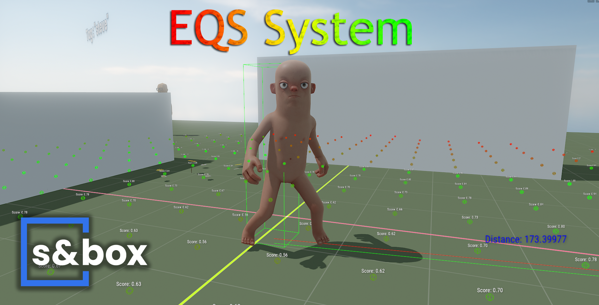
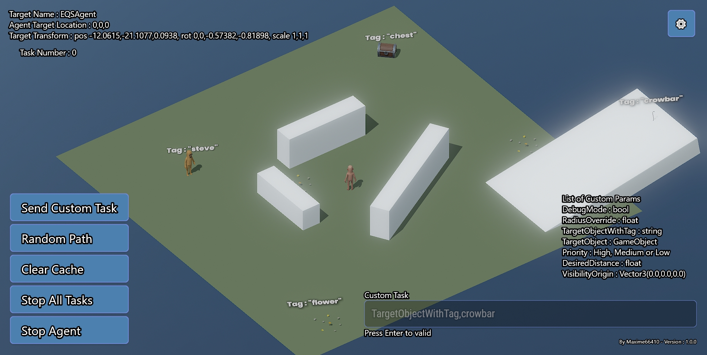
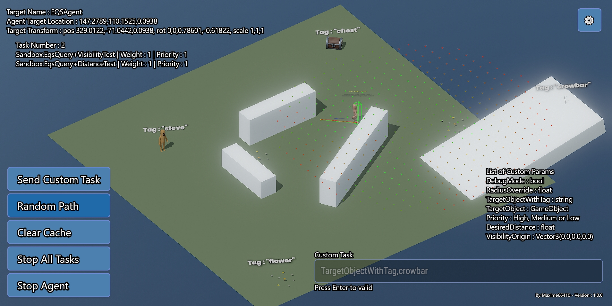
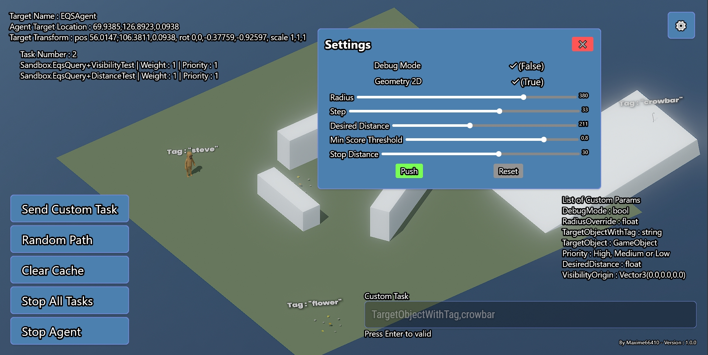

<p align="center">
  
</p>

# EQS System for S&Box

An Environment Query System for [S&Box](https://sbox.game), inspired by the one in Unreal Engine.
The AI generates points around itself, scores them with a set of tests and walks to one of the best.

> [!NOTE]
> This project was made in December 2024 and still compiles on the current version of S&Box.
> I'm not actively working on it anymore, so feel free to take it over and do whatever you want with it.

## Demo

https://github.com/user-attachments/assets/2a393568-c05b-4d66-8af4-4779744cc96e

Without the HUD:

https://github.com/user-attachments/assets/4e1cdaab-f7f9-4580-a4a7-8ffaa6e34ae6

## Features

* Point generation in a 2D circle or a 3D sphere around the agent
* Scoring tests for visibility, distance, target, flatness and custom radius
* Weighted random pick, so agents don't always go to the same spot
* NavMesh movement that detects when the agent gets stuck
* Debug overlay with every scored point, the path and the active tests
* In game control panel to run queries and tweak settings live

## How it works

1. **Generate** points on a grid around the agent, using `Radius` and `Step`.
2. **Score** each point with every test, weighted by `Weight` and `Priority`, then normalize the scores.
3. **Pick** a random point among those above `minScoreThreshold`, where better points are more likely.
4. **Move** the agent there with its `NavMeshAgent`.

## Getting started

1. Clone the repo and open `eqssystem.sbproj` in S&Box.
2. Open `Assets/scenes/minimal.scene` and press Play.
3. Use the panel on the left to send queries to the agent.

To use it on your own agent, add the `EqsQuery` component to a GameObject that has a `NavMeshAgent` and a `CitizenAnimationHelper`.
Your scene needs a NavMesh. Give the object the `eqsentity` tag if you want the control panel to find it.

## Usage

```csharp
var eqs = GameObject.GetComponent<EqsQuery>();

// Default visibility and distance tests
eqs.CallRequest();

// With custom parameters
eqs.CallRequest( null, null, new Dictionary<string, object>
{
	{ "Priority", "High" },
	{ "TargetObjectWithTag", "crowbar" },
	{ "RadiusOverride", 500.0f },
	{ "DebugMode", true }
} );
```

### Custom parameters

* `VisibilityOrigin` (Vector3) adds a visibility test from another position
* `DesiredDistance` (float) adds a distance test with another distance
* `Priority` (string) can be `High`, `Medium` or `Low`
* `TargetObject` (GameObject) moves toward this object
* `TargetObjectWithTag` (string) moves toward the closest object with this tag
* `RadiusOverride` (float) changes the search radius
* `DebugMode` (bool) shows or hides the debug overlay

In the in game panel, type them as `Key,Value`, for example `TargetObjectWithTag,crowbar` or `RadiusOverride,500f`.
Press Enter, then click **Send Custom Task**.

### Component settings

* `bDebugMode` shows the debug overlay. Default is `false`.
* `bUse2D` generates points in a circle instead of a sphere. Default is `true`.
* `Radius` is the search radius. Default is `100`.
* `Step` is the distance between two points. Default is `10`.
* `DesiredDistance` is the ideal distance for the distance test. Default is `50`.
* `minScoreThreshold` is the lowest score a point needs to be picked. Default is `0.8`.
* `StopDistance` is how close the agent gets before stopping. Default is `30`.

### Writing your own test

Inherit from `EqsQuery.EqsTest` and return a score for each point.

```csharp
public class HeightTest : EqsQuery.EqsTest
{
	public override float GetScore( Vector3 point )
	{
		return point.z > 50f ? 1.0f : 0.0f;
	}
}
```

Add it to the `Tests` list of the component and call `Execute()` to get the scored points.

## Screenshots

The demo scene with the control panel



A random path query with every scored point



The settings window



## License

Released under the [MIT License](LICENSE).

Made by [Maxime66410](https://github.com/Maxime66410).
